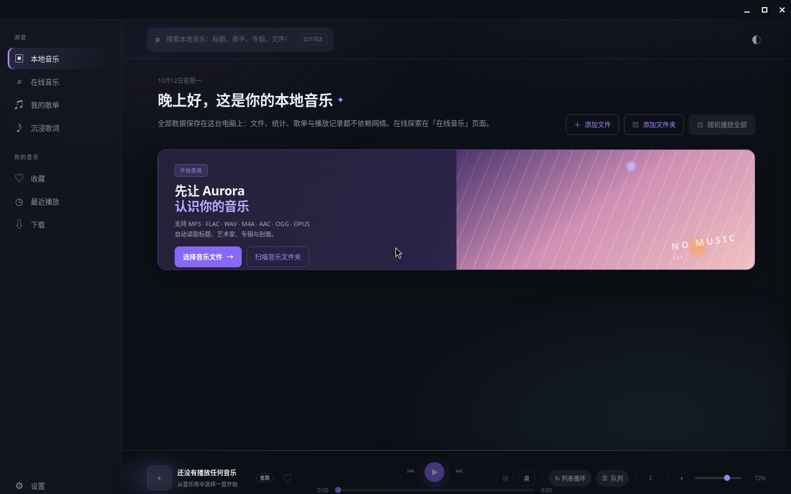
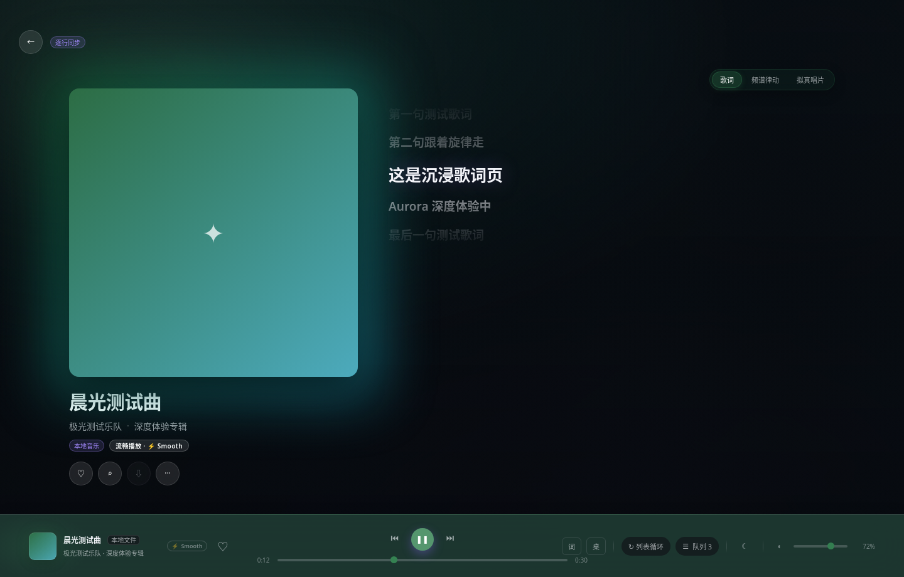
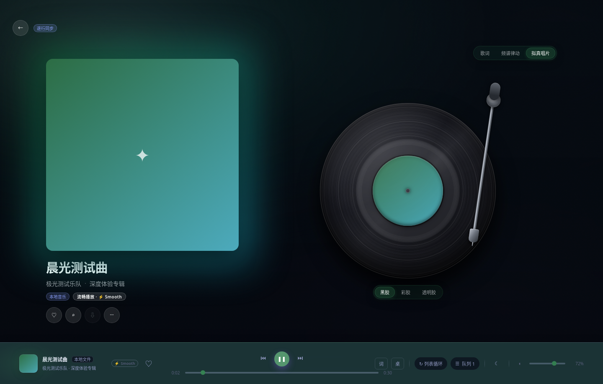
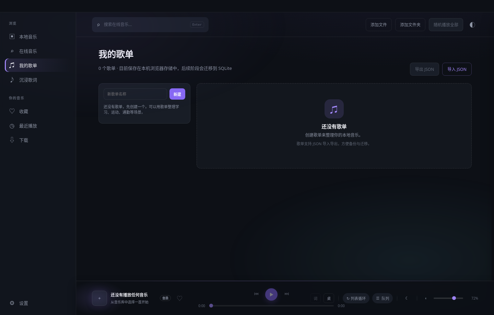
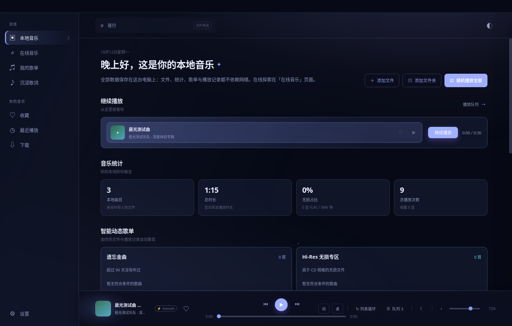

<h1 align="center">Aurora Music</h1>

<p align="center">
  一款 Windows 优先、跨平台兼容的<b>本地优先</b>桌面音乐播放器<br/>
  导入本地音乐、多音源聚合搜索、沉浸式歌词、插件化音源系统，一个应用全部搞定
</p>

<p align="center">
  <a href="https://github.com/virtux712-beep/Aurora-Music-v0.1.0/releases"></a>
  <a href="https://github.com/virtux712-beep/Aurora-Music-v0.1.0/releases"></a>
  
  
  
  
</p>

<p align="center">
  <a href="#下载"><b>⬇️ 下载安装</b></a> ·
  <a href="docs/USER-GUIDE.md"><b>📖 使用手册</b></a> ·
  <a href="#功能亮点"><b>✨ 功能亮点</b></a> ·
  <a href="docs/DEVELOPMENT.md"><b>🛠 开发文档</b></a> ·
  <a href="docs/RELEASE-NOTES-0.1.0.md"><b>📝 发布说明</b></a>
</p>

## 界面预览

<p align="center">
  
</p>

| 沉浸式歌词 | 黑胶播放 |
| :---: | :---: |
|  |  |

| 歌单 | 搜索与主题 |
| :---: | :---: |
|  |  |

## 为什么选 Aurora

- 🎧 **本地优先**：音乐库、封面、收藏、历史、歌单、队列全部保存在本机，离线可用，不依赖任何云服务
- 🔌 **真正的插件化音源**：能力模型 + 注册表 + 沙箱运行时 + 按主机授权；JSON 清单音源和 JS 脚本音源（含洛雪风格兼容）都能装，装完立即生效
- 🎤 **歌词是第一公民**：同目录 `.lrc`、内嵌标签、手动导入三级来源，逐行 / 逐字同步，桌面歌词与 F11 沉浸模式
- 🛡️ **安全默认开启**：脚本音源跑在隔离沙箱里，联网要逐个主机授权；密钥用系统级加密保存，不进渲染层

## 下载

当前版本 **v0.1.0**，适用于 Windows 10 / 11（x64）：

| 版本 | 说明 | 下载 |
| --- | --- | --- |
| **安装版** | NSIS 安装程序，一路下一步 | [Aurora-Music-Setup-0.1.0-x64.exe](https://github.com/virtux712-beep/Aurora-Music-v0.1.0/releases/download/v0.1.0/Aurora-Music-Setup-0.1.0-x64.exe) |
| **便携版** | 解压即用，免安装 | [portable.zip](https://github.com/virtux712-beep/Aurora-Music-v0.1.0/releases/download/v0.1.0/portable.zip) |
| **源码包** | 完整源码（与本仓库一致） | [Aurora-Music-0.1.0-source.zip](https://github.com/virtux712-beep/Aurora-Music-v0.1.0/releases/download/v0.1.0/Aurora-Music-0.1.0-source.zip) |

历史版本与更新内容见 [Releases](https://github.com/virtux712-beep/Aurora-Music-v0.1.0/releases)。

## 功能亮点

**本地音乐**

- 文件多选导入或递归扫描整个文件夹，带导入进度
- music-metadata 读取标题 / 艺术家 / 专辑 / 时长；内嵌封面自动缓存
- 万首级音乐库虚拟滚动不卡顿，支持排序、筛选、定位文件

**播放与歌词**

- 列表循环 / 单曲循环 / 随机 / 顺序；队列拖动排序，重启自动恢复
- 系统托盘、任务栏缩略图按钮、全局媒体键、Media Session 全支持
- 沉浸式歌词：模糊封面背景、逐字高亮、点击歌词跳转；独立桌面歌词窗口可锁定

**在线与音源系统**

- 内置五家平台**搜索**（酷我 / 网易云 / QQ / 酷狗 / 咪咕，仅搜索与元数据）
- 声明式音源：一份 JSON 清单（URL 模板 + 字段映射 + 主机白名单）接入你自己的 API，不执行任何代码
- 脚本音源：导入 `.js` 或整包导入洛雪音源库 `user_api.json`，沙箱实跑预览后再安装
- 音源管理即时生效：启用 / 禁用 / 排序 / 配置表单 / 连通性测试 / 后台健康检查

**下载与管理**

- 下载队列：并发、断点续传、暂停 / 继续 / 重试，进度、速度、剩余时间实时显示
- 文件名模板、MP3 自动写入 ID3 标签（含封面），重启后任务与文件都在
- 收藏、播放历史、歌单（JSON 导入导出）、音乐统计一应俱全

## 快速开始（开发）

```bash
npm install
npm run dev          # 开发模式
npm run build        # 构建安装版 + 便携版到 release/
npm run verify       # 类型检查 + Lint + 全部冒烟测试 + 构建
```

## 文档

- [使用手册](docs/USER-GUIDE.md)：安装、导入、播放、歌词与音源的完整说明
- [开发文档](docs/DEVELOPMENT.md)：架构、数据落盘位置、测试体系
- [发布说明 v0.1.0](docs/RELEASE-NOTES-0.1.0.md)
- [音源运行时设计](docs/SOURCE-RUNTIME-DESIGN.md) · [视觉引擎](docs/visual-engine.md) · [洛雪对齐路线图](docs/LX-PARITY-ROADMAP.md)

## 技术栈

| 层 | 技术 |
| --- | --- |
| 桌面运行时 | Electron 34（contextIsolation + sandbox） |
| 界面 | Vue 3 + Vue Router + Pinia |
| 语言 / 构建 | TypeScript 5 + electron-vite + electron-builder |
| 元数据 | music-metadata |

## 安全与法律说明

Aurora 本身不包含任何绕过 DRM、避开访问控制或破解鉴权的代码，也不内置任何平台曲库：内置的只有五家平台**搜索**（本身放不出声音），可播放的音源全部由使用者自行安装，运行在受权限约束的沙箱里。音源能访问什么、播放什么，取决于使用者与该来源之间的约定及运行时授予的主机权限。

<p align="center">如果 Aurora 对你有用，欢迎点一个 ⭐ 支持一下。</p>
