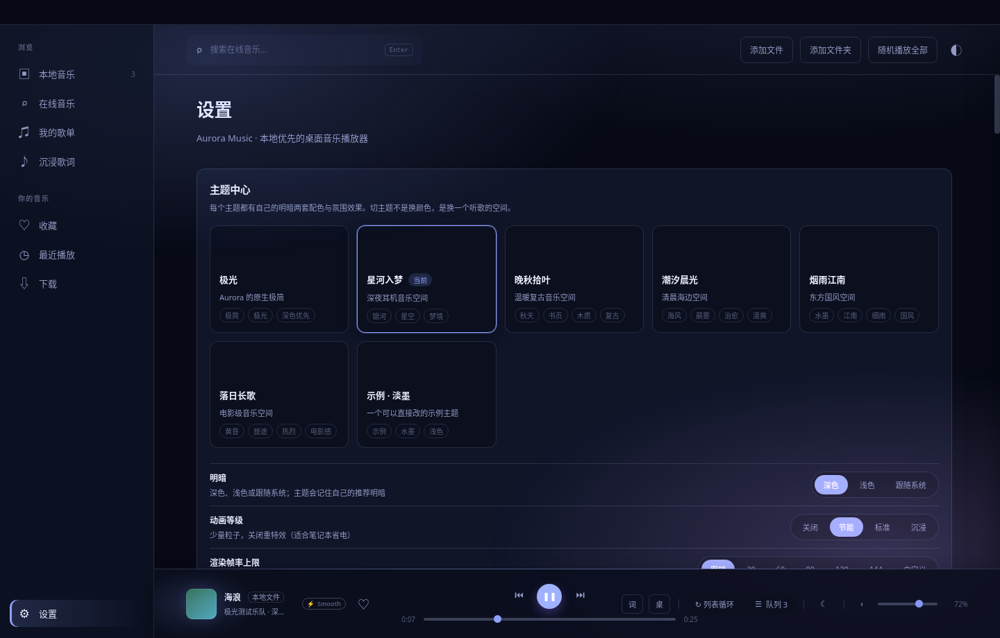

<p align="center">
  
</p>

<h1 align="center">Aurora Music</h1>

<p align="center">
  <strong>把你的音乐库，装进一片极光里。</strong><br/>
  一款 Windows 优先、跨平台兼容的<b>本地优先</b>桌面音乐播放器<br/>
  本地曲库 · 多音源聚合 · 沉浸式歌词 · 插件化音源系统，一个应用全部搞定
</p>

<p align="center">
  <a href="https://github.com/virtux712-beep/Aurora-Music/releases"></a>
  <a href="https://github.com/virtux712-beep/Aurora-Music/releases"></a>
  <a href="https://github.com/virtux712-beep/Aurora-Music/releases/tag/v0.4.0%E7%A8%B3%E5%AE%9A%E7%89%88"></a>
  
  
  
  
  
</p>

<p align="center">
  <a href="#-项目信息"><b>📊 项目信息</b></a> ·
  <a href="#-下载"><b>⬇️ 下载安装</b></a> ·
  <a href="#-三步开始"><b>🚀 三步开始</b></a> ·
  <a href="docs/USER-GUIDE.md"><b>📖 使用手册</b></a> ·
  <a href="#-版本特色"><b>🧭 版本特色</b></a> ·
  <a href="#-功能亮点"><b>✨ 功能亮点</b></a> ·
  <a href="#-架构一览"><b>🏗 架构一览</b></a> ·
  <a href="CHANGELOG.md"><b>📝 更新日志</b></a> ·
  <a href="#-常见问题"><b>❓ 常见问题</b></a> ·
  <a href="docs/README.md"><b>📚 文档中心</b></a>
</p>

<table align="center">
  <tr>
    <td align="center" width="25%"><h3>🎧 本地优先</h3>曲库、封面、收藏、歌单<br/>全部保存在本机，离线可用</td>
    <td align="center" width="25%"><h3>🔌 插件化音源</h3>JSON 清单音源 + JS 脚本音源<br/>含洛雪风格兼容，装完即生效</td>
    <td align="center" width="25%"><h3>🎤 歌词第一公民</h3>逐行 / 逐字同步<br/>桌面歌词 + F11 沉浸模式</td>
    <td align="center" width="25%"><h3>🛡️ 安全默认开启</h3>脚本音源隔离沙箱运行<br/>联网逐主机授权，密钥加密保存</td>
  </tr>
</table>

## 📊 项目信息

| 项目 | 内容 |
| --- | --- |
| 当前版本 | **v0.4.0 稳定版**（2026-10-31 发布） |
| 版本历程 | 共 5 个公开版本：v0.1.0（2026-09-18 首发）→ v0.2.0 → v0.3.0 → v0.3.1 → v0.4.0 |
| 支持平台 | Windows 10 / 11（x64），提供安装版与便携版 |
| 安装包体积 | 安装版约 82 MB · 便携版约 82 MB · 源码包约 2.1 MB |
| 技术栈 | Electron 34 · Vue 3 · TypeScript 5 · SQLite |
| 功能完整度 | 52 / 52（功能状态全绿） |
| 质量基线 | 源码回归 295/295 × 3 轮 · npm audit 0 漏洞（v0.4.0 实测） |
| 发布通道 | GitHub Releases（仅此官方渠道） |
| 反馈渠道 | [Issues](https://github.com/virtux712-beep/Aurora-Music/issues)（Bug 报告 / 功能请求模板） |

## 📸 界面预览

<p align="center">
  
</p>

<table align="center">
  <tr>
    <td align="center"><br/><sub><b>沉浸式歌词</b> · 模糊封面背景，逐字高亮</sub></td>
    <td align="center"><br/><sub><b>黑胶播放</b> · 唱片转动，氛围拉满</sub></td>
  </tr>
  <tr>
    <td align="center"><br/><sub><b>歌单</b> · JSON 导入导出，随身带走</sub></td>
    <td align="center"><br/><sub><b>主题系统</b> · 内置主题 + 自定义主题文件</sub></td>
  </tr>
</table>

<p align="center">
  
  <br/><sub><b>聚合搜索</b> · 五家平台一次搜齐</sub>
</p>

## 🎨 主题墙 · 视觉与主题 2.0

自 v0.3.0 起内置 **10 套主题**，在主题中心一键切换，还能导入你自己的主题（v0.3.1 起主题中心带健康诊断）：

<table align="center">
  <tr>
    <td align="center" width="20%">🌌<br/><b>极光</b></td>
    <td align="center" width="20%">🌠<br/><b>星河入梦</b></td>
    <td align="center" width="20%">🍂<br/><b>晚秋拾叶</b></td>
    <td align="center" width="20%">🌅<br/><b>潮汐晨光</b></td>
    <td align="center" width="20%">🌧️<br/><b>烟雨江南</b></td>
  </tr>
  <tr>
    <td align="center" width="20%">🌇<br/><b>落日长歌</b></td>
    <td align="center" width="20%">🌊<br/><b>深海回声</b></td>
    <td align="center" width="20%">🌲<br/><b>晨雾森林</b></td>
    <td align="center" width="20%">🌃<br/><b>霓虹雨夜</b></td>
    <td align="center" width="20%">🌙<br/><b>纸上月光</b></td>
  </tr>
</table>

- **主题中心**：实时迷你播放器预览、正文对比度不足提示、导出当前主题、复制主题 JSON、用户主题导入 / 删除
- **Theme Schema v2**：动效配方、玻璃 / 阴影层级、歌词默认效果、胶片显示参数、图标色调、布局密度；旧 v1 用户主题继续兼容
- **歌词效果可覆盖**：跟随主题 / 聚焦 / 纸张 / 水波 / 水墨 / 胶片字幕 / 霓虹

### 🎬 胶片模式

> 独立开关，不依赖主题。打开之后，整个播放界面像放一部老电影：

- 胶片颗粒、暗角、上下遮幅
- 暖色 / 冷色 grade，轻微门闪（gate weave）
- 24 / 30fps 视觉节奏，暂停时冻结
- 低能耗模式自动关闭颗粒与门闪

## 💡 为什么选 Aurora

<table>
  <tr>
    <td width="50%" valign="top">
      <h3>🎧 本地优先，不绑云</h3>
      音乐库、封面、收藏、历史、歌单、队列全部保存在本机，不依赖任何云服务；万首级曲库虚拟滚动，导入、搜索、定位都不卡。
    </td>
    <td width="50%" valign="top">
      <h3>🔌 真正的插件化音源</h3>
      能力模型 + 注册表 + 沙箱运行时 + 按主机授权：声明式 JSON 清单音源零代码接入，JS 脚本音源（含洛雪风格）沙箱实跑预览后再安装，管理即时生效。
    </td>
  </tr>
  <tr>
    <td width="50%" valign="top">
      <h3>🎤 歌词是第一公民</h3>
      同目录 <code>.lrc</code>、内嵌标签、手动导入三级来源，逐行 / 逐字同步、点击跳转；独立桌面歌词窗口可锁定，F11 进入沉浸模式。
    </td>
    <td width="50%" valign="top">
      <h3>🛡️ 安全默认开启</h3>
      脚本音源跑在隔离沙箱里（无 Node 能力、网络全拦截），联网要逐个主机授权；密钥用系统级加密保存，永不进入渲染层。
    </td>
  </tr>
</table>

## ⬇️ 下载

当前版本 **v0.4.0 稳定版**（2026-10-31），适用于 Windows 10 / 11（x64）：

| 版本 | 说明 | 下载 |
| --- | --- | --- |
| **安装版** | NSIS 安装程序，推荐日常使用（约 82 MB） | [Aurora-Music-Setup-0.4.0-x64.exe](https://github.com/virtux712-beep/Aurora-Music/releases/download/v0.4.0%E7%A8%B3%E5%AE%9A%E7%89%88/Aurora-Music-Setup-0.4.0-x64.exe) |
| **便携版** | 免安装绿色版，双击即用（约 82 MB） | [Aurora-Music-Portable-0.4.0-x64.exe](https://github.com/virtux712-beep/Aurora-Music/releases/download/v0.4.0%E7%A8%B3%E5%AE%9A%E7%89%88/Aurora-Music-Portable-0.4.0-x64.exe) |
| **源码包** | 完整源码打包（约 2.1 MB） | [Aurora-Music-0.4.0-source.zip](https://github.com/virtux712-beep/Aurora-Music/releases/download/v0.4.0%E7%A8%B3%E5%AE%9A%E7%89%88/Aurora-Music-0.4.0-source.zip) |
| **使用手册** | v0.4.0 随发布附带的用户手册 | [USER-GUIDE-0.4.0.md](https://github.com/virtux712-beep/Aurora-Music/releases/download/v0.4.0%E7%A8%B3%E5%AE%9A%E7%89%88/USER-GUIDE-0.4.0.md) |
| **发布说明** | v0.4.0 随发布附带的完整说明 | [RELEASE-NOTES-0.4.0.md](https://github.com/virtux712-beep/Aurora-Music/releases/download/v0.4.0%E7%A8%B3%E5%AE%9A%E7%89%88/RELEASE-NOTES-0.4.0.md) |

历史版本（v0.3.1 / v0.3.0 / v0.2.0 / v0.1.0）见 [Releases](https://github.com/virtux712-beep/Aurora-Music/releases)；各版本的特色对比见下方 [🧭 版本特色](#-版本特色)。

## 🚀 三步开始

<table align="center">
  <tr>
    <td align="center" width="33%"><h3>1️⃣ 下载并启动</h3>从上方下载安装版或便携版<br/>双击启动（Windows 10 / 11 x64）</td>
    <td align="center" width="33%"><h3>2️⃣ 导入本地音乐</h3>选文件或整个文件夹导入<br/>封面与歌曲信息自动读取</td>
    <td align="center" width="33%"><h3>3️⃣ 开听</h3>本地音乐立刻能听<br/>在线音乐去「设置 → 音源管理」装你自己的音源</td>
  </tr>
</table>

## 🧭 版本特色

五个公开版本，一条清晰的演进线：先把功能做全（v0.1.0–v0.2.0），再把视觉做透（v0.3.0–v0.3.1），最后把可靠性收口（v0.4.0）。

| 版本 | 发布日期 | 主题 | 状态 |
| --- | --- | --- | --- |
| **v0.4.0** | 2026-10-31 | 播放可靠性与稳定性收口 | **稳定版 · 当前版本** |
| **v0.3.1** | 2026-10-31 | 视觉一致性收口 | 稳定版 |
| **v0.3.0** | 2026-10-30 | 视觉与主题 2.0 | 原候选版，已由 v0.3.1 收口 |
| **v0.2.0** | 2026-10-29 | 迷你播放器与可访问性 | 稳定版 |
| **v0.1.0** | 2026-09-18 | 首个公开版本 | 稳定版 |

<details open>
<summary><b>v0.4.0 稳定版 · 播放可靠性收口</b>（2026-10-31）— <a href="https://github.com/virtux712-beep/Aurora-Music/releases/tag/v0.4.0%E7%A8%B3%E5%AE%9A%E7%89%88">发布页</a></summary>

- **播放倍速**：0.5× / 0.75× / 1.0× / 1.25× / 1.5× / 2.0× 六档，双 deck 同步、保持音高，重启后保留
- **睡眠唤醒恢复**：系统睡眠时暂停，只有睡眠前正在播放才在唤醒后恢复；输出设备断开自动回退系统默认输出
- **聚合搜索不再被慢源拖死**：单音源截止时间 + TIMEOUT 结果行；同一音源结果自动去重，重复项补齐封面、音质与播放地址
- **歌词防串**：快速切歌有 request-token + track id 双守卫，旧歌曲的歌词不会落到新歌曲下
- **单实例运行**：重复启动时聚焦已有窗口并退出，不再开两个 Aurora
- **安全与性能收口**：依赖升级后 npm audit 0 漏洞；IPC 增加 renderer URL allowlist；频谱 / 唱盘暂停后释放 rAF；源码回归 295/295 × 3 轮

</details>

<details>
<summary><b>v0.3.1 · 视觉一致性收口</b>（2026-10-31）— <a href="https://github.com/virtux712-beep/Aurora-Music/releases/tag/v0.3.1">发布页</a></summary>

- **三套动效节奏**：列表 fade + rise、设置 fade + scale、歌词独立 Teleport 入场；时长与缓动统一到 `--dur-*` / `--ease-*` 令牌，`check:motion` 禁止裸写
- **歌词逐字填充改用音频连续时钟**：不再受 4Hz `timeupdate` 阶梯影响；seek 后当前行、逐字填充与滚动位置保持一致
- **频谱与唱盘打磨**：频谱改对数频段 + 峰值保持；唱盘新增 lead-in groove、locked run-out 与唱针自动抬起；暂停 / 低能耗自动释放帧循环
- **语义令牌统一**：圆角、间距、阴影全量迁移到语义 token（`--shadow-panel` 等）；新增统一 EmptyState / LoadingState / ErrorState 组件
- **设置页分区导航**：5 组 sticky 分区、14 个锚点，长设置页可跳转
- **主题中心健康诊断**：「复制为自定义主题」；主题卡提示缺失 token、氛围配方缺失、对比度过低，坏主题可展开看具体原因；`check:accent` 主题色审计
- **质量**：smoke:app 290/290 × 3 轮，a11y 路由审计 8/8

</details>

<details>
<summary><b>v0.3.0 · 视觉与主题 2.0</b>（2026-10-30）— <a href="https://github.com/virtux712-beep/Aurora-Music/releases/tag/v0.3.0">发布页</a></summary>

- **10 套内置主题**：极光、星河入梦、晚秋拾叶、潮汐晨光、烟雨江南、落日长歌、深海回声、晨雾森林、霓虹雨夜、纸上月光
- **Theme Schema v2**：动效配方、玻璃 / 阴影层级、歌词默认效果、胶片参数、图标色调、布局密度；v1 用户主题继续兼容
- **胶片模式**：颗粒、暗角、上下遮幅、冷暖 grade 与门闪，独立开关
- **统一 SVG 图标**：核心操作不再依赖 Unicode 字形
- **沉浸播放页与歌词效果升级**：歌词效果可覆盖（跟随主题 / 聚焦 / 纸张 / 水波 / 水墨 / 胶片字幕 / 霓虹）
- 发布时为候选版；视觉一致性已由 v0.3.1 收口，当前稳定版为 v0.4.0

</details>

<details>
<summary><b>v0.2.0 · 迷你播放器与可访问性</b>（2026-10-29）— <a href="https://github.com/virtux712-beep/Aurora-Music/releases/tag/v0.2.0">发布页</a></summary>

- **迷你播放器窗口**：独立置顶小窗（封面 / 进度 / 上一首 / 下一首），与主窗口共享播放状态，位置与置顶自动记住 —— 功能清单的第 52 项就此补齐，功能状态 52/52
- **可访问性全面改进**：主要路由自动审计 7/7 通过；播放栏、图标按钮、弹窗补齐可访问名；曲库与队列行支持键盘聚焦、Enter 播放、Delete 移除
- **质量**：端到端检查扩至 278 项，新增未处理异常断言与三档宽度溢出检查

</details>

<details>
<summary><b>v0.1.0 · 首个公开版本</b>（2026-09-18）— <a href="https://github.com/virtux712-beep/Aurora-Music/releases/tag/v0.1.0">发布页</a> · <a href="docs/RELEASE-NOTES-0.1.0.md">发布说明</a></summary>

- **本地曲库**：文件 / 文件夹导入、music-metadata 元数据与内嵌封面、万首级虚拟滚动
- **插件化音源系统**：声明式 JSON 清单音源零代码接入；JS 脚本音源（含洛雪风格）隔离沙箱运行、联网按主机授权
- **沉浸式歌词**：三级歌词来源、逐行 / 逐字同步、桌面歌词窗口、F11 沉浸模式
- **下载管理**：队列并发、断点续传、文件名模板、MP3 自动写 ID3 标签
- **数据全本地**：收藏、历史、歌单、统计、完整备份 / 恢复；可选本机只读 HTTP API

</details>

每个版本的完整改动说明见 [更新日志 CHANGELOG](CHANGELOG.md)，历史版本文件见 [Releases](https://github.com/virtux712-beep/Aurora-Music/releases)。

## ✨ 功能亮点

### 本地音乐

- 文件多选导入或递归扫描整个文件夹，带导入进度
- music-metadata 读取标题 / 艺术家 / 专辑 / 时长；内嵌封面自动缓存
- 万首级音乐库虚拟滚动不卡顿，支持排序、筛选、定位文件

### 播放与歌词

- 双声道交叉淡化与无缝衔接；列表循环 / 单曲循环 / 随机 / 顺序，队列拖动排序，重启自动恢复
- 迷你播放器：独立置顶小窗（封面 / 进度 / 上一首 / 下一首），与主窗口共享播放状态，位置与置顶自动记住
- 系统托盘、任务栏缩略图按钮、全局媒体键、Media Session 全支持
- 沉浸式歌词：模糊封面背景、逐字高亮、点击歌词跳转；独立桌面歌词窗口可锁定
- 响度均衡、睡眠定时、主题与视觉引擎（粒子 / 帧率治理）
- 播放倍速（v0.4.0）：0.5×–2.0× 六档，双 deck 同步、保持音高，设置重启后保留
- 睡眠唤醒与设备恢复（v0.4.0）：系统睡眠自动暂停、唤醒按睡眠前状态恢复；输出设备断开自动回退系统默认输出
- 单实例运行（v0.4.0）：重复启动自动聚焦已有窗口
- 视觉一致性（v0.3.1）：三套页面动效节奏与统一动效令牌、语义阴影、统一空 / 加载 / 错误状态组件；设置页 5 组分区导航；频谱对数频段 + 峰值保持，唱盘拟真沟槽与唱针动作
- 主题系统 2.0（v0.3.0）：10 套内置主题、Theme Schema v2、主题中心（实时预览 / 对比度提示 / 导入导出），旧版用户主题继续兼容
- 胶片模式（v0.3.0）：颗粒、暗角、上下遮幅与冷暖色调，独立开关，低能耗自动降级
- 统一 SVG 图标与动效系统（v0.3.0）：核心操作不再依赖 Unicode 字形；页面进入动效、焦点环与弹窗焦点管理，尊重「减少动态」偏好

### 在线与音源系统

- 内置五家平台**搜索**（酷我 / 网易云 / QQ / 酷狗 / 咪咕，仅搜索与元数据）
- 声明式音源：一份 JSON 清单（URL 模板 + 字段映射 + 主机白名单）接入你自己的 API，不执行任何代码
- 脚本音源：导入 `.js` 或整包导入洛雪音源库 `user_api.json`，沙箱实跑预览后再安装
- 音源管理即时生效：启用 / 禁用 / 排序 / 配置表单 / 连通性测试 / 后台健康检查
- 聚合搜索可靠性（v0.4.0）：单音源截止时间与 TIMEOUT 结果行，慢源不再拖死整张结果表；同源结果自动去重并补齐封面 / 音质 / 播放地址；快速切歌时歌词有双重守卫，不会串到下一首

### 下载与管理

- 下载队列：并发、断点续传、暂停 / 继续 / 重试，进度、速度、剩余时间实时显示
- 文件名模板、MP3 自动写入 ID3 标签（含封面），重启后任务与文件都在
- 收藏、播放历史、歌单（JSON 导入导出）、音乐统计一应俱全
- 完整备份 / 恢复；可选的本机只读 HTTP API（默认关闭，仅 127.0.0.1 + 令牌）

## ❓ 常见问题

<details>
<summary><b>需要联网吗？本地音乐能离线听吗？</b></summary>
<br/>不需要。曲库、封面、收藏、歌单全部保存在本机，本地音乐离线可用；只有在线搜索与音源功能才需要网络。
</details>

<details>
<summary><b>为什么有些歌搜得到却放不了？</b></summary>
<br/>内置的只有五家平台<b>搜索</b>（酷我 / 网易云 / QQ / 酷狗 / 咪咕，仅搜索与元数据，本身放不出声音）。可播放的音源由你自行在「设置 → 音源管理」中安装，装完即时生效。
</details>

<details>
<summary><b>支持哪些系统？</b></summary>
<br/>Windows 10 / 11（x64），提供 NSIS 安装版与免安装便携版。
</details>

<details>
<summary><b>下载的文件怎么校验完整性？</b></summary>
<br/>请只从本仓库的 Releases 页面下载官方版本，发布资产以 GitHub 托管为准。若某个版本的发布页附带 <code>SHA256SUMS.txt</code> 校验文件，可下载后比对 SHA-256 哈希确认文件完整（当前 v0.4.0 未附带校验文件）。
</details>

<details>
<summary><b>我的数据存在哪里？会上传吗？</b></summary>
<br/>全部保存在本机，不依赖任何云服务。应用内提供完整备份 / 恢复；具体的落盘位置见 <a href="docs/DEVELOPMENT.md">开发文档</a>。
</details>

<details>
<summary><b>遇到问题或想要新功能，去哪反馈？</b></summary>
<br/>到 <a href="https://github.com/virtux712-beep/Aurora-Music/issues">Issues</a> 用模板提交 Bug 报告或功能请求；贡献流程见 <a href="CONTRIBUTING.md">贡献指南</a>。
</details>

## 🏗 架构一览


三层隔离是 Aurora 的地基：**Node 能力只存在于主进程**，渲染层只能通过受校验的桥接 API 访问文件与网络；脚本音源再单独关进一个断网的沙箱窗口，全部外联经主进程按主机授权放行。细节见 [开发文档](docs/DEVELOPMENT.md) 与 [音源运行时设计](docs/SOURCE-RUNTIME-DESIGN.md)。

## 🛠 快速开始（开发）

```bash
npm install
npm run dev          # 开发模式
npm run build        # 构建安装版 + 便携版到 release/
npm run verify       # 类型检查 + Lint + 全部冒烟测试 + 构建
```

## 📚 文档

全部文档见 [文档中心](docs/README.md)：

- [更新日志](CHANGELOG.md)：每个版本的改动说明与版本历史
- [使用手册](docs/USER-GUIDE.md)：安装、导入、播放、歌词与音源的完整说明
- [开发文档](docs/DEVELOPMENT.md)：架构、数据落盘位置、测试体系
- [发布说明 v0.1.0](docs/RELEASE-NOTES-0.1.0.md)
- [使用手册 v0.4.0](https://github.com/virtux712-beep/Aurora-Music/releases/download/v0.4.0%E7%A8%B3%E5%AE%9A%E7%89%88/USER-GUIDE-0.4.0.md) · [发布说明 v0.4.0](https://github.com/virtux712-beep/Aurora-Music/releases/download/v0.4.0%E7%A8%B3%E5%AE%9A%E7%89%88/RELEASE-NOTES-0.4.0.md)（随 v0.4.0 发布页附带）
- [音源运行时设计](docs/SOURCE-RUNTIME-DESIGN.md) · [视觉引擎](docs/visual-engine.md) · [洛雪对齐路线图](docs/LX-PARITY-ROADMAP.md)

## 🧱 技术栈

| 层 | 技术 |
| --- | --- |
| 桌面运行时 | Electron 34（contextIsolation + sandbox） |
| 界面 | Vue 3 + Vue Router + Pinia |
| 语言 / 构建 | TypeScript 5 + electron-vite + electron-builder |
| 数据 | SQLite（node-sqlite3-wasm）+ 本地文件镜像 |
| 元数据 | music-metadata |

## ⚖️ 安全与法律说明

Aurora 本身不包含任何绕过 DRM、避开访问控制或破解鉴权的代码，也不内置任何平台曲库：内置的只有五家平台**搜索**（本身放不出声音），可播放的音源全部由使用者自行安装，运行在受权限约束的沙箱里。音源能访问什么、播放什么，取决于使用者与该来源之间的约定及运行时授予的主机权限。

---

<p align="center">
  如果 Aurora 对你有用，欢迎点一个 ⭐ 支持一下。<br/>
  <sub>Aurora Music · 为本地音乐库而作</sub>
</p>
